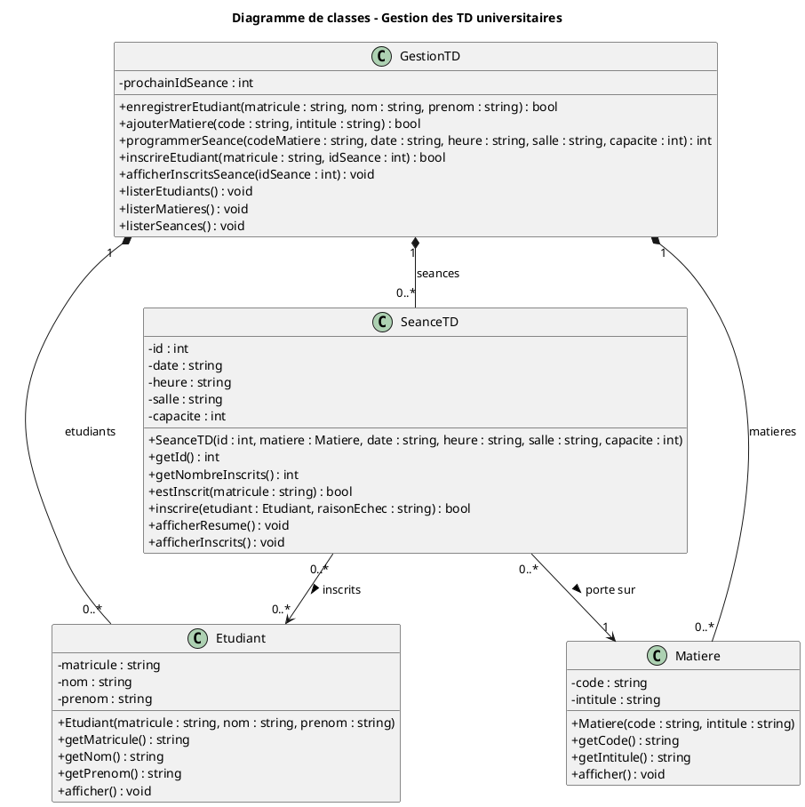

# Travaux pratiques de Programmation Orientée Objet

## Exercice de réinvestissement : Gestion des travaux dirigés (TD) universitaires

**Langage :** C++ (norme C++17)  
**Outil de modélisation :** PlantUML  
**Pièces jointes :** `diagramme_uml.pdf`, `main.cpp`

## Partie A : Modélisation UML

### 1. Identification des classes

L'analyse du contexte conduit à identifier quatre classes.

| Classe | Rôle |
|---|---|
| `Etudiant` | Représente un étudiant de l'université, identifié par son matricule. |
| `Matiere` | Représente une matière enseignée (mathématiques, physique, informatique). |
| `SeanceTD` | Représente une séance de TD précise : elle porte sur une matière, se déroule à une date, une heure et dans une salle données, et regroupe les étudiants inscrits. |
| `GestionTD` | Classe de service qui détient les collections d'objets et expose les opérations de l'application. |

Les trois premières classes correspondent aux concepts du domaine. La classe `GestionTD` ne figure pas dans l'énoncé ; elle a été ajoutée afin de ne pas surcharger la fonction `main` et de regrouper la logique de gestion en un seul endroit.

### 2. Attributs et méthodes

**Classe `Etudiant`**

- Attributs : `matricule : string`, `nom : string`, `prenom : string`.
- Méthodes : un constructeur, les accesseurs `getMatricule()`, `getNom()`, `getPrenom()`, et `afficher()`.

**Classe `Matiere`**

- Attributs : `code : string`, `intitule : string`.
- Méthodes : un constructeur, les accesseurs `getCode()` et `getIntitule()`, et `afficher()`.

**Classe `SeanceTD`**

- Attributs : `id : int`, `date : string`, `heure : string`, `salle : string`, `capacite : int`, `matiere : shared_ptr<Matiere>` et `inscrits : vector<shared_ptr<Etudiant>>`.
- Méthodes : un constructeur, `estInscrit(matricule)`, `inscrire(etudiant, raisonEchec)`, `getNombreInscrits()`, `afficherResume()` et `afficherInscrits()`.

**Classe `GestionTD`**

- Attributs : trois `vector` (étudiants, matières, séances) et un compteur servant à générer les identifiants de séances.
- Méthodes : `enregistrerEtudiant()`, `ajouterMatiere()`, `programmerSeance()`, `inscrireEtudiant()`, `afficherInscritsSeance()`, `listerEtudiants()`, `listerMatieres()` et `listerSeances()`.

Tous les attributs sont privés, conformément au principe d'encapsulation.

### 3. Associations et cardinalités

| Association | Cardinalités | Justification |
|---|---|---|
| `SeanceTD` → `Matiere` | `0..*` côté séance, `1` côté matière | Une séance porte sur exactement une matière ; une matière peut donner lieu à plusieurs séances, voire à aucune pour le moment. |
| `SeanceTD` → `Etudiant` | `0..*` des deux côtés | Un étudiant peut s'inscrire à plusieurs séances et une séance accueille plusieurs étudiants. Il s'agit d'une association plusieurs-à-plusieurs. |
| `GestionTD` ◆— `Etudiant`, `Matiere`, `SeanceTD` | `1` côté `GestionTD`, `0..*` côté objets gérés | Composition : `GestionTD` possède les collections et en gère le cycle de vie. |

L'association plusieurs-à-plusieurs entre `Etudiant` et `SeanceTD` est matérialisée par l'attribut `inscrits` de la classe `SeanceTD`.

### 4. Diagramme de classes

Le diagramme de classes est fourni dans le fichier `diagramme_uml.pdf`. Il a été réalisé avec PlantUML à partir du code source suivant.



---

## Partie B : Implémentation en C++

### 1. Présentation du programme

L'application est une application console contenue dans le fichier `main.cpp`. Elle se compile et s'exécute de la manière suivante :

```bash
g++ -std=c++17 -Wall -Wextra -o td main.cpp
./td            # menu interactif
./td --test     # scénario de test automatique
```

Le menu principal propose les fonctionnalités demandées :

1. enregistrer un étudiant ;
2. ajouter une matière ;
3. programmer une séance de TD ;
4. inscrire un étudiant à une séance ;
5. afficher la liste des étudiants inscrits à une séance ;
6. lister les étudiants, les matières et les séances, afin de retrouver facilement les identifiants.

### 2. Respect des contraintes de l'énoncé

| Contrainte | Mise en œuvre |
|---|---|
| Utiliser au minimum les classes `Etudiant`, `Matiere` et `SeanceTD` | Ces trois classes sont implémentées, complétées par la classe `GestionTD`. |
| Respecter l'encapsulation | Tous les attributs sont déclarés `private` ; l'accès se fait par des accesseurs et des méthodes publiques. |
| Utiliser les constructeurs et les méthodes | Chaque classe possède un constructeur à liste d'initialisation et des méthodes dédiées à ses responsabilités. |
| Utiliser `vector` pour gérer les collections | Des `vector` sont utilisés pour les étudiants, les matières, les séances, ainsi que pour les inscrits de chaque séance. |
| Empêcher la double inscription | La méthode `SeanceTD::inscrire()` appelle d'abord `estInscrit(matricule)` et refuse l'inscription si l'étudiant figure déjà dans la liste. |

### 3. Choix de conception

- **Unicité des identifiants.** Le matricule d'un étudiant et le code d'une matière doivent être uniques ; dans le cas contraire, l'enregistrement est refusé. L'identifiant d'une séance est généré automatiquement.
- **Utilisation de `shared_ptr`.** Une séance référence sa matière et ses étudiants sans les copier. L'emploi de pointeurs bruts vers des éléments d'un `vector` aurait été risqué : une réallocation du tableau lors d'un `push_back` invaliderait ces pointeurs. Les `shared_ptr` évitent ce problème et dispensent de la gestion manuelle de la mémoire.
- **Capacité d'une séance.** Un attribut de capacité a été ajouté, bien que l'énoncé ne l'exige pas : une séance complète refuse toute nouvelle inscription. Cette règle est facilement retirable en supprimant le test correspondant dans `SeanceTD::inscrire()`.
- **Gestion des erreurs.** Les champs vides, les matières, étudiants ou séances inexistants et les doublons sont signalés par un message explicite, sans interrompre le programme.

---

## Partie C : Tests et restitution

### 1. Scénario de test

Le scénario est exécuté par la commande `./td --test`. Le tableau suivant en présente le détail et les résultats.

| N° | Action testée | Résultat attendu | Résultat obtenu |
|---|---|---|---|
| 1 | Enregistrement de trois étudiants, puis d'un étudiant au matricule déjà utilisé | Trois succès, un refus | Conforme |
| 2 | Ajout de trois matières, puis d'une matière au code déjà utilisé | Trois succès, un refus | Conforme |
| 3 | Programmation de deux séances, puis d'une séance sur une matière inexistante | Deux succès, un refus | Conforme |
| 4 | Inscriptions valides | Inscriptions acceptées | Conforme |
| 5 | Double inscription du même étudiant à la même séance | Inscription refusée | Conforme |
| 6 | Inscription à une séance dont la capacité est atteinte | Inscription refusée | Conforme |
| 7 | Inscription d'un étudiant ou à une séance inexistants | Message d'erreur | Conforme |
| 8 | Affichage des inscrits de chaque séance | Listes correctes | Conforme |

### 2. Vérification de la double inscription

Le test 5 répond directement à l'exigence de l'énoncé. L'étudiant E001 est d'abord inscrit à la séance n° 1, puis une seconde tentative est effectuée. Le programme la refuse :

```
=== Test 5 : double inscription (doit etre refusee) ===
[REFUSE] Inscription impossible : l'etudiant est deja inscrit a cette seance.
```

Le test 6 vérifie de la même manière le refus d'une inscription dans une séance complète, et le test 8 confirme l'affichage correct des inscrits :

```
=== Test 6 : seance pleine (capacite 2, doit etre refusee) ===
[REFUSE] Inscription impossible : la seance est complete.

=== Test 8 : liste des inscrits par seance ===
Seance #1 | Informatique | 20/11/2026 08:00 | salle Salle A1 | 2/2 inscrits
  1. E001 - AGBO Koffi
  2. E002 - HOUNKPATIN Afi
Seance #2 | Mathematiques | 21/11/2026 10:00 | salle Salle B2 | 1/30 inscrits
  1. E001 - AGBO Koffi
```

Le programme se compile sans aucun avertissement avec les options `-Wall -Wextra`. Le menu interactif a également été éprouvé : enregistrement, création de séance, inscription, rejet de la double inscription et affichage des inscrits fonctionnent comme prévu.

### 3. Présentation synthétique

L'application repose sur quatre classes. `Etudiant` et `Matiere` décrivent les données de base. `SeanceTD` représente une séance : elle est liée à une matière et contient, dans un `vector`, la liste des étudiants inscrits. `GestionTD` regroupe les collections et les opérations. Le diagramme UML montre qu'une séance porte sur une seule matière et que les étudiants et les séances sont en relation plusieurs-à-plusieurs. La double inscription est bloquée dans la méthode `SeanceTD::inscrire()`, et ce comportement a été validé par le scénario de test.

---

## Question de réflexion

**Pourquoi est-il préférable de créer une classe `SeanceTD` plutôt que de placer directement toutes les informations d'une séance dans la classe `Matiere` ?**

Plusieurs arguments justifient la création d'une classe distincte.

Premièrement, une matière donne lieu à plusieurs séances. Une matière comme l'informatique est enseignée lors de nombreux TD, à des dates, des heures et dans des salles différentes. Intégrer ces informations à `Matiere` obligerait soit à dupliquer la matière pour chaque séance, soit à multiplier les tableaux parallèles (dates, salles, listes d'inscrits), ce qui est fragile et peu lisible.

Deuxièmement, cette séparation respecte le principe de responsabilité unique. Une `Matiere` décrit ce qui est enseigné (code et intitulé), tandis qu'une `SeanceTD` décrit un événement concret (quand, où et avec qui). Ces deux notions évoluent indépendamment : la salle d'une séance peut changer sans que la matière soit affectée.

Troisièmement, les inscriptions se rapportent à une séance précise et non à la matière en général. Un étudiant s'inscrit à un TD particulier. Avec une classe `SeanceTD`, la règle interdisant la double inscription et la gestion de la capacité trouvent naturellement leur place dans cette classe.

Quatrièmement, cette organisation évite la redondance : le code et l'intitulé d'une matière sont stockés une seule fois, et toutes les séances y font référence. Une correction apportée à la matière se répercute ainsi partout.

Enfin, elle facilite l'évolution du programme. L'ajout d'un enseignant, d'un type de séance ou d'un statut (annulée, reportée) ne nécessite de modifier que `SeanceTD`, la classe `Matiere` restant simple et stable.
